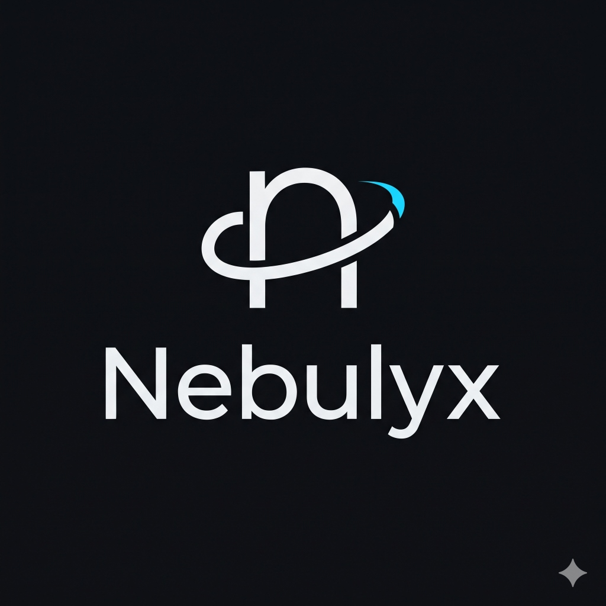
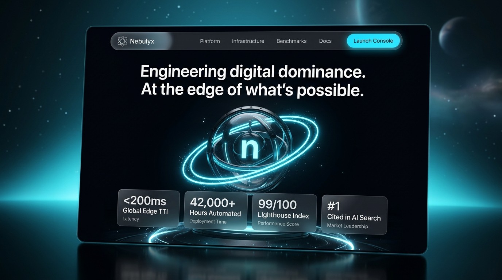
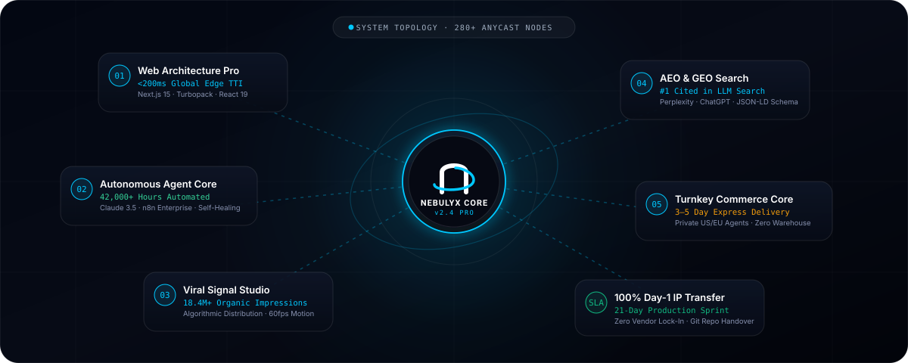
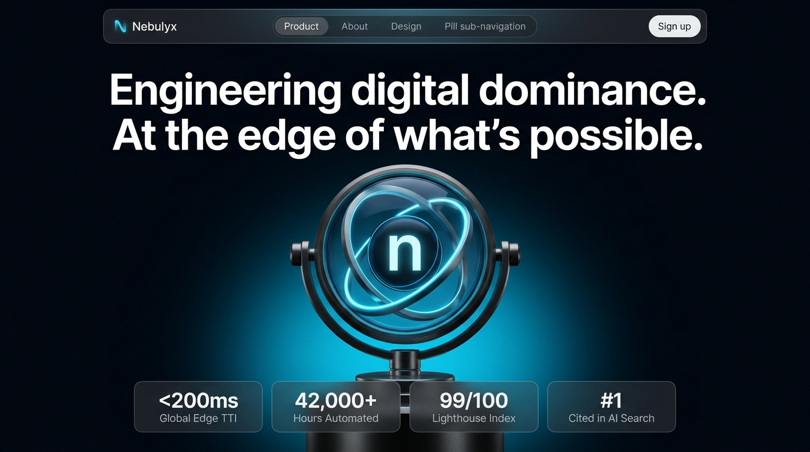
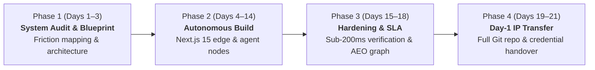

<div align="center">

  

  # NEBULYX
  ### Digital Architecture & Autonomous Growth Systems

  <p align="center">
    <strong>Engineered for category leaders who refuse compromise.</strong><br/>
    Sub-200ms edge platforms · Self-healing multi-agent pipelines · Algorithmic distribution · AEO search dominance · Turnkey commerce.
  </p>

  <p align="center">
    
    
    
    
    
    
  </p>

  <br />

  

</div>

---

## ✦ Overview

**Nebulyx** replaces traditional, slow agency retainers with contractually guaranteed **21-day production sprints**. Designed with Apple's ecosystem philosophy—monolithic typography, milled titanium aesthetics, dark obsidian glass, and kinetic micro-interactions—Nebulyx builds systems that eliminate human operational friction and establish undeniable market dominance.

```
                 ┌───────────────────────────────────────────────┐
                 │           NEBULYX KERNEL (v2.4 PRO)           │
                 │   Next.js 15 · Claude 3.5 · Cloudflare Edge   │
                 └──────┬──────────┬──────────┬──────────┬───────┘
                        │          │          │          │
        ┌───────────────┴┐  ┌──────┴────────┐ │ ┌────────┴────────┐
        │ 01. Web Edge   │  │ 02. Neural    │ │ │ 04. AEO Search   │
        │ <200ms TTI     │  │ 42k+ Hrs Auto │ │ │ #1 Cited in AI   │
        └────────────────┘  └───────────────┘ │ └──────────────────┘
                               ┌──────────────┴──┐
                               │ 03. Viral Studio│
                               │ 18.4M+ Reach    │
                               └─────────────────┘
```

---

## ✦ System Architecture & Topology

<div align="center">
  
</div>

---

## ✦ Five Core Disciplines

### 1. High-Performance Website Building
- **Edge Next.js 15 Architecture**: Hybrid Server Actions, edge SSR/ISR, and V8 Isolate routing.
- **Sub-200ms Global TTI**: Distributed across 280+ worldwide CDN Anycast points.
- **Lighthouse Standard**: Guaranteed 99+ score across Performance, SEO, and Accessibility.
- **Micro-Interactions**: GPU-accelerated 60 FPS WebGL canvas and tactile Web Audio feedback.

### 2. Autonomous Multi-Agent Workflows
- **Neural Reasoning**: Powered by Anthropic Claude 3.5 Sonnet and OpenAI GPT-4o.
- **Self-Healing Orchestration**: Enterprise event-driven pipelines via self-hosted n8n.
- **Zero-Latency Event Bus**: Eliminates manual clerical bottlenecks, saving over 42,000+ client hours annually.

### 3. Algorithmic Social Distribution Studio
- **High-Retention Signal Engine**: Video assets engineered specifically for platform algorithms.
- **Omnipresent Flywheel**: Cross-platform distribution across TikTok, LinkedIn, YouTube Shorts, and X.
- **Authority Positioning**: Thought leadership pipelines turning viewers into qualified enterprise leads.

### 4. AEO & GEO Marketing (Answer & Generative Engine Optimization)
- **The Post-Google Paradigm**: When enterprise buyers query **Perplexity, ChatGPT, Claude, and Gemini**, Nebulyx ensures your brand is cited as the definitive primary source.
- **Knowledge Graph Injection**: Schema.org JSON-LD semantic entity structures indexed directly into LLM retrieval corpuses.
- **Hallucination Mitigation**: Factual grounding that guarantees AI models represent your specs and offerings accurately.

### 5. Turnkey Scaled Dropshipping & Commerce
- **Private Logistics Network**: Direct factory-partnered agents with **3–5 day express delivery** across the US and Europe.
- **Headless Storefronts**: Sub-second checkout built on Shopify Plus GraphQL and Stripe Elements.
- **Zero Inventory Holding**: 100% automated order-to-tracking fulfillment without static warehouse liabilities.

---

## ✦ Design & Cinematic Presentation

<div align="center">
  
</div>

---

## ✦ Technical Specifications (Tech Specs)

| Specification | Nebulyx Pro Standard | Industry Benchmark |
| :--- | :--- | :--- |
| **Frontend Runtime** | Next.js 15 (Turbopack) & React 19 | Legacy Webpack / Monoliths |
| **Global Edge Latency** | **Sub-200ms TTI** across 280+ PoPs | 2.4s – 4.8s average |
| **AI Reasoning Core** | Anthropic Claude 3.5 Sonnet + GPT-4o | Static rule-based scripts |
| **Workflow Uptime SLA** | **99.8% Autonomous Execution** | Manual human bottleneck |
| **Search Engine Target** | **Perplexity Pro & ChatGPT Search #1** | Outdated Google keyword density |
| **Supply Chain SLA** | **3–5 Day Express Tracked Delivery** | 20–30 day slow drop postal |
| **Code & IP Custody** | **100% Day-1 Complete IP Transfer** | Proprietary lock-in / Retainers |
| **Sprint Turnaround** | **Contractual 10 to 21-Day Sprint** | 3 to 6 months waterfall |

---

## ✦ The 21-Day Execution Protocol



---

## ✦ Production Benchmarks

- **`< 200ms`** — Global Time-to-Interactive (TTI) verified on edge CDN.
- **`42,000+`** — Verifiable operational hours automated for clients annually.
- **`99 / 100`** — Google Lighthouse performance and accessibility standard.
- **`#1 Cited`** — Primary recommended authority in Perplexity and ChatGPT search results.
- **`100%`** — Intellectual property, Git repositories, and cloud credentials transferred on Day 1.

---

## ✦ Quickstart & Local Development

### Prerequisites
- Node.js `20.x` or later
- npm or pnpm

### Installation
```bash
# Clone the repository
git clone https://github.com/nebulyx/nebulyx-platform.git
cd nebulyx-platform

# Install dependencies
npm install

# Start development server
npm run dev
```

### Production Build
```bash
# Compile and bundle with Vite
npm run build

# Preview production build locally
npm run preview
```

---

## ✦ Deployment Targets

Nebulyx is built for zero-latency edge delivery:
- **Cloudflare Pages / Workers**: Anycast global edge deployment.
- **Vercel**: One-click edge runtime support (`vercel deploy`).
- **Netlify**: Edge Functions & CDN distribution (`netlify deploy --prod`).

---

## ✦ Contractual SLA & IP Sovereignty

Every Nebulyx engagement is governed by a mutual contractual SLA:
1. **100% Day-1 IP Rights**: All source code, Git history, vector stores, and infrastructure credentials belong exclusively to you from Day 1.
2. **Guaranteed Sprint Timeline**: Fixed 21-day delivery milestone with zero billable hourly bloat.
3. **Sub-200ms Performance SLA**: Contractually backed speed and uptime standards.

---

<div align="center">
  <p>© 2026 Nebulyx Platform Inc. All rights reserved. Zero vendor lock-in.</p>
</div>
